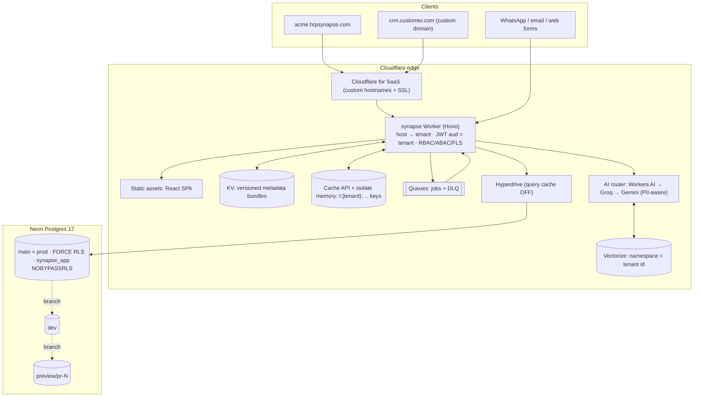

# Architecture

## System view



The SPA and the API are served by one Worker, using Workers Static Assets with `run_worker_first: ["/api/*"]`. This replaces the separate Cloudflare Pages project I mentioned in Step 1, for two reasons:

- Pages custom domains cannot be wildcards, and every tenant subdomain needs to reach the same app.
- Same-origin hosting removes CORS and third-party-cookie problems for the refresh token.

Static asset requests are free and don't count against Worker invocations.

## Request lifecycle

```mermaid
sequenceDiagram
  participant B as Browser (acme.hrpsynapse.com)
  participant W as Worker
  participant C as Edge cache
  participant D as Postgres (Hyperdrive)
  B->>W: GET /api/v1/records/lead (Bearer JWT)
  W->>C: p:host:acme.hrpsynapse.com
  alt miss
    W->>D: app.resolve_tenant_by_host() (SECURITY DEFINER, narrow)
  end
  W->>W: jwtVerify(aud = tenant:{id}) → wrong-tenant tokens fail here
  W->>C: t:{tid}:meta:v{meta_version} / t:{tid}:principal:{uid}
  W->>D: BEGIN READ ONLY; set_config('app.tenant_id', tid, true) …
  W->>D: SELECT … WHERE tenant_id = $1 AND <scope> AND <abac> (RLS also applies)
  D-->>W: rows
  W->>W: drop hidden fields (FLS) → DTO
  W-->>B: 200 (Cache-Control: no-store)
```

## Data model

All tenant tables live in one schema. Every table has `tenant_id`, every index starts with `tenant_id`, and every cross-record reference is a composite foreign key `(tenant_id, x_id)`. That means Postgres itself rejects a reference to another tenant's row, separately from RLS.

| Group | Tables |
|---|---|
| Platform | `tenants`, `tenant_domains`, `public_routes` |
| Identity | `users` (with ABAC `attributes`, `manager_id`), `roles` (permissions JSON), `user_roles`, `sessions` |
| Metadata | `custom_objects`, `custom_fields`, `pipelines`, `pipeline_stages`, `forms`, `tenant_modules` |
| CRM | `leads`, `contacts`, `accounts`, `deals`, `records` (custom objects), `record_index`, `tasks`, `activities` |
| Automation and comms | `workflows`, `workflow_runs`, `channel_accounts`, `messages`, `webhook_subscriptions` |
| AI | `kb_documents`, `kb_chunks`, `ai_usage` |
| Compliance | `audit_logs` (append-only, trigger-maintained) |

### Metadata engine: JSONB plus an EAV index

- Custom field values live in each record's `custom jsonb`, so a record is read in one row with no joins.
- Fields marked *filterable* are mirrored by trigger into `record_index`. These are typed rows (`v_text`, `v_num`, `v_date`, `v_bool`) with B-tree indexes. Filtering and sorting on a custom field therefore uses an index without per-tenant DDL on shared tables.
- Standard objects are also rows in `custom_objects`, so fields, layouts, permissions, forms and modules treat every object the same way.
- Any change to metadata bumps `tenants.meta_version` (via a trigger). Edge cache keys include that version, so caches roll over without explicit purges.

### Industry modules

`packages/shared/src/modules.ts` defines declarative manifests for Real Estate, Healthcare, E-Commerce and Financial Services. Each manifest has objects, fields on standard objects, pipelines, starter automations, and AI domain context. Installing a module is idempotent and tags every artifact it creates with `module_key`.

To add a vertical, write a manifest and register it in `MODULES`. No schema change is needed.

## Background work

The Worker's `queue()` handler processes these job types:

- `record.event`: workflows and outbound webhooks
- `ai.score_lead`
- `kb.index`
- `message.send` and `message.inbound`
- `webhook.deliver`

Every job carries `tenantId` and re-establishes tenant context itself. If no queue is bound, jobs run in `waitUntil` after the response, so the app still works with zero queue usage.

Oracle Cloud ARM is reserved for work that doesn't fit Workers limits: IMAP sync, bulk imports and batch re-embedding. Those jobs would pull from the same queue over HTTP using the same job contract. That part isn't built yet; see the roadmap.

## Key decisions

| Decision | Why |
|---|---|
| Pooled database with RLS (not schema-per-tenant) | One migration path and catalog. Scales to thousands of tenants on the free tier. A large enterprise tenant can later move to its own Neon project behind the same `tenants` registry. |
| Transaction-local tenant context | `set_config(…, true)` disappears at commit, so pooled connections (Hyperdrive, PgBouncer) can't leak context between tenants. |
| Hyperdrive query cache disabled | The cache keys on SQL text and parameters only and doesn't see session settings, so it could serve one tenant's rows to another. |
| Hand-written SQL migrations, not ORM migrations | RLS policies, SECURITY DEFINER functions and triggers are the core of the design and need exact SQL. The API uses a small typed query layer over `pg`, which runs both in Workers (TCP sockets) and in Node tests. |
| React + Vite SPA (not Next.js) | Every screen is authenticated and tenant-specific, so SSR/ISR adds nothing. It keeps the Worker bundle and CPU budget small. |
| UUIDv7 primary keys | Time-ordered, so they are B-tree friendly, and safe to expose. |
